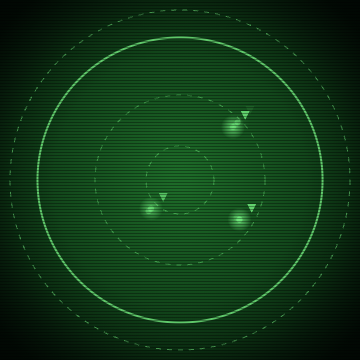
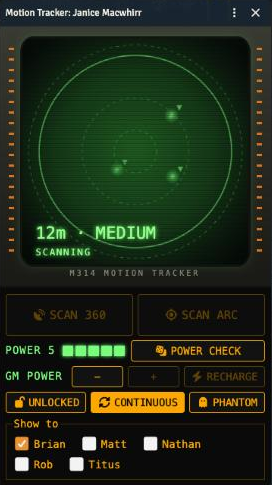

# Alien Motion Tracker

A motion tracker for the **Alien RPG** on [Foundry VTT](https://foundryvtt.com) (v13–14), built to run *Hope's Last Day* and any other game where the squad needs to hear something coming.

The GM's client works out what is moving, including hidden tokens, and sends the players only a range, a bearing and a band. Players never receive token names, positions or ids, so nothing leaks.

<p>
  
  &nbsp;
  
</p>

*Left: the scanner screen mid-scan (Movie CRT look). Right: the GM's window with battery, Power check, lock, continuous, phantom and "Show to" controls. The ▼ marks a contact on a lower floor.*

## What it does

- **Detects motion, not presence.** A token pings only if it moved recently (30 seconds by default, a setting). A xeno waiting in a vent is silent until you move it.
- **Sees hidden tokens.** Visibility doesn't matter. If a hidden Drone moves, it pings, like a real ultrasound sensor.
- **Works through walls and ducts.** Distance is a straight line, so walls don't block it.
- **Per-token control.** The GM's Token HUD gets one button that cycles **Auto**, **Always moving** (the mice in the Sterile Lab) and **Dormant** (a Drone that stays silent however you move it).
- **Lock and unlock.** The GM locks each tracker. A locked tracker shows OFFLINE and refuses scans. Unlock it and the player presses **SCAN**.
- **Scans come in bursts.** One press runs 3 sweeps and then the screen goes dark on STANDBY. That maps to one Fast Action, and it keeps the players guessing between scans. The GM can set a tracker to **Continuous** for scripted moments.
- **Range bands.** Four rings (Short, Medium, Long, Extreme), plus a readout of the nearest contact in meters, `23m · MEDIUM`, with ±1m jitter so it isn't a laser rangefinder.
- **Floors on one scene.** Draw regions named `MT Level 1`, `MT Level 2` and so on, and contacts on another floor read as above or below (▲ ▼) with the floor height added to the distance.
- **Optional Power roll.** With the setting on, each SCAN rolls the system's own supply roll for the character's *M314 Motion Tracker* item. Rolling 1s drains Power and glitches the screen, and at 0 the tracker shows NO POWER.
- **Battery and Power checks.** The tracker shows its Power as battery cells and has a **POWER CHECK** button: it rolls dice equal to the current Power, each 1 drains 1 Power, and a panel (plus a chat card) explains the result in plain words. At 0 Power the tracker goes dark and refuses scans until the GM recharges it. The GM gets **-1 / +1 / Recharge** buttons on the window.
- **Follows the character.** A tracker belongs to a character, so it keeps working on whichever scene their token is in.

## More for the GM

Switched on in settings, off by default. Each one is walked through with pictures in the **[GM guide](docs/GM-GUIDE.md)**:

- **Directional scans** (SCAN 360 / SCAN ARC) with a visible cone on the screen.
- **Phantom contacts**: click the screen to place a fake blip.
- **Jamming zones**: name a region `MT Jam` and readings inside it go wrong.
- **Swarms**: tokens share a name, read as one blip far away and split when they close in.
- **Private sound**: only you and the players under Show to hear or see the tracker. Optional direction panning.
- **Looks**: a Movie CRT skin (default) or the Classic one, with trails and subtle idle glitches.

## Install

In Foundry: **Add-on Modules → Install Module**, and paste this manifest URL:

```
https://github.com/bohn002/alien-tracker/releases/latest/download/module.json
```

Then enable **Alien Motion Tracker** in your world. Requires Foundry v13 or v14 and the [Alien RPG system](https://foundryvtt.com/packages/alienrpg).

> The manifest only works once a release has been published. For local development, symlink this folder into Foundry's `Data/modules/` as `hope-motion-tracker`.

## Using it

### GM setup (once per character)

1. Select the character's token and click the satellite-dish button in the token controls.
2. A tracker window opens, **locked**. The character's owners are added as viewers.
3. Click **LOCKED** to unlock it when the scene calls for it. Use **Show to** to choose who sees it.

Players get their own window automatically when they are made a viewer, and the dish button reopens it. Trackers belong to a character, not a token, so they keep working when the character changes scene.

### The tracker window

| Control | Who | What it does |
|---|---|---|
| **SCAN** (or **SCAN 360** / **SCAN ARC**) | players, GM | Runs one burst of sweeps (3 by default), then the screen pulses on STANDBY. Disabled while locked or mid-scan. |
| **POWER n** and the battery cells | everyone who can see the character | Current charge. Green at 4–5, yellow at 2–3, red and pulsing at 1, grey at 0. |
| **POWER CHECK** | players, GM | Rolls dice equal to the current Power. Each 1 drains 1 Power. A panel and a chat card explain the result. |
| **− / + / RECHARGE** | GM only | Set the Power by hand. + and Recharge are disabled when full, − when empty. |
| **LOCKED / UNLOCKED** | GM only | A locked tracker shows OFFLINE and refuses scans and Power checks. |
| **PHANTOM** | GM only | Then click the screen to place a fake contact. |
| **CONTINUOUS** | GM only | The tracker sweeps on its own until you switch it off, for scripted moments. |
| **Show to** | GM only | Which players get this tracker. |

At 0 Power the tracker shows NO POWER and refuses scans until the GM recharges it, as in a dead battery that needs replacing.

### Setting up tokens

Right-click a token and click the motion button on the Token HUD until it shows what you want:

| Mode | Pings when |
|---|---|
| Auto | the token moved in the last 30 seconds |
| Always moving | every scan (mice, a scratching vent, a Drone battering a door) |
| Dormant | never, however it moves |

### Several floors on one scene

Draw one rectangle Region per floor and name them `MT Level 1`, `MT Level 2`, and so on. They must be the same size and line up so the same spot on each floor has the same offset. Each token is measured from the top-left corner of its own floor. Scenes without these regions are measured as one flat plane.

## Settings

All under **Configure Settings → Alien Motion Tracker**. Defaults in brackets.

| Setting | What it does |
|---|---|
| Scanner range (50m) | Contacts farther than this are ignored |
| Short / Medium / Long band (10 / 25 / 50m) | Where each range band ends |
| Seconds per sweep (2) | Time for the ring to cross the screen |
| Sweeps per scan (3) | Length of one SCAN burst |
| Motion window (30s) | How long a move counts as motion |
| Detect player characters (on) | Moving PCs ping too |
| Floor height (3m) | Added between `MT Level` floors |
| Readout jitter (on) | ±1m on the readout |
| Allow directional scans (off) | Adds SCAN ARC beside SCAN 360 |
| Directional cone width (90°) / range multiplier (1.5×) | How the arc scan looks and how far it reaches |
| Jamming zones (off) | Regions named `MT Jam` scramble readings |
| Swarm splitting (off) | Token HUD swarm names group tokens into one blip at range |
| Battery size (5) | Maximum Power charges. Recharge fills to this |
| Roll for power (off) | Each SCAN first makes a Power check automatically |
| Sound files | Sweep, close, medium and far sounds |
| Scanner volume (per player, 0.8) | Each player's own volume |
| Scanner look (per player, Movie CRT) | Movie CRT or Classic |
| Phosphor trails (per player, on) | Past blips linger as faint dots |
| Idle screen glitches (per player, on) | Subtle static and flicker when idle |
| Pan sounds by direction (per player, off) | Stereo pan and muffle by bearing |

## How it works

- The GM's client (the highest-role connected GM) listens for token moves, builds the contact list on each sweep, and sends it over Foundry's module socket.
- The scan button sends a request over the socket. The GM client checks that the tracker is unlocked and that the player is a viewer or owns the character before it runs.
- The screen is a plain Canvas 2D drawing, with no extra graphics libraries.

## Related

- [Explain My Roll](https://github.com/bohn002/explain-my-roll) adds a plain-language explanation under every Alien RPG roll card, for players new to the system. It started life in this module and is now separate.

## Not included

- Hope's Last Day or any other Alien RPG content. You need the adventure and system from [Free League](https://freeleaguepublishing.com).
- Contacts across scenes. Each scan covers the scene holding the carrier's token.

## Credits and license

- Screen artwork and sounds come from [pplans' Alien RPG Motion Tracker](https://github.com/pplans/foundry-vtt-module-motion-tracker) (MIT). See [`assets/CREDITS.md`](assets/CREDITS.md).
- Code is released under the [MIT License](LICENSE).

*This is an unofficial fan module. It is not affiliated with or endorsed by Free League Publishing, Foundry Gaming LLC or the owners of the ALIEN franchise. ALIEN and related marks belong to their respective owners.*
