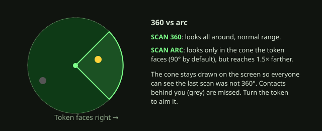
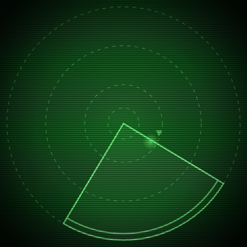
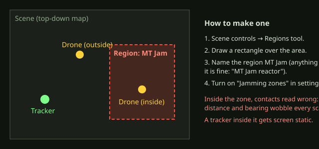
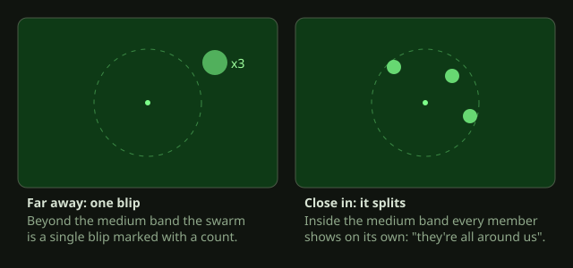
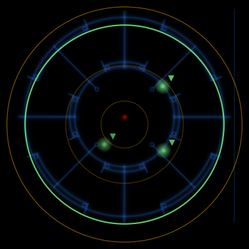

# GM guide: running the tracker

A walkthrough of everything the tracker can do at the table, in the order you'll need it. Every extra feature in here is **off by default** and switched on in **Configure Settings → Alien Motion Tracker**, so a fresh install behaves like the plain tracker.

1. [First time setup](#1-first-time-setup)
2. [Scanning and the screen](#2-scanning-and-the-screen)
3. [Battery and Power checks](#3-battery-and-power-checks)
4. [Multiple floors on one scene](#4-multiple-floors-on-one-scene)
5. [Directional scans](#5-directional-scans)
6. [Phantom contacts](#6-phantom-contacts)
7. [Jamming zones](#7-jamming-zones)
8. [Swarms](#8-swarms)
9. [Sound](#9-sound)
10. [Looks](#10-looks)

---

## 1. First time setup

1. Select a character's token and click the satellite dish in the token controls (the left toolbar, Tokens group).
2. A tracker window opens, **LOCKED**. The character's owners are added under **Show to** automatically.
3. Click **LOCKED** to unlock it when the scene calls for it.

Then mark what moves. Right-click a token and cycle the motion button on its HUD: **Auto** (pings if it moved in the last 30 seconds), **Always moving** (mice, a scratching vent) or **Dormant** (never pings). A hidden Drone is detected just like a visible one, as long as it moved.

## 2. Scanning and the screen

Press **SCAN**. The screen sweeps three times, then settles on STANDBY (the word pulses). Contacts appear as blips. Faint dots left behind show where each one was on earlier sweeps, so you can see which way it's heading. ▲ and ▼ mark a contact on a higher or lower floor.

Only you and the players under **Show to** receive the tracker's data and sounds. Nobody else at the table hears it.

## 3. Battery and Power checks

The cells show the charge: green at 4–5, yellow at 2–3, red and pulsing at 1, grey at 0. **POWER CHECK** rolls dice equal to the current Power and every 1 drains a charge; a panel and a chat card explain what happened. At 0 the tracker reads NO POWER and refuses scans.

You (GM only) get **−**, **+** and **RECHARGE** to set it by hand. The maximum is the **Battery size** setting (5 by default).

## 4. Multiple floors on one scene

Draw one rectangle Region per floor, same size and lined up, and name them `MT Level 1`, `MT Level 2`... Contacts on another floor read ▲ or ▼ and add the floor height (3m by default) to their distance.

## 5. Directional scans

Turn on **Allow directional scans**. The SCAN button splits in two:

- **SCAN 360**: all around, normal range.
- **SCAN ARC**: only the cone the token is facing (width and extra range are settings), and the cone is drawn on the screen.

Rotate the token on the map to aim it. Tokens facing south have rotation 0.

## 6. Phantom contacts

Use these for steam vents, scuttling pests, or a nervous character's imagination.

1. Open the tracker window (GM only).
2. Click **PHANTOM**. The cursor turns into a crosshair.
3. Click on the screen where the fake contact should be.
4. It shows up on the next scans, for two sweeps, and then fades. Players see an ordinary blip.

## 7. Jamming zones

Turn on **Jamming zones**, then draw a region.

- A **contact inside** a jam region reads with a distance and bearing that wobble from scan to scan.
- A **tracker inside** one gets screen static and the same wobble on everything it sees.

Use it around reactors, cooling towers, comm dishes: anywhere the electronics should misbehave. The region only needs its name to start with `MT Jam`.

## 8. Swarms

Turn on **Swarm splitting**. A new button on the Token HUD (a bug icon) lets you give a token a **swarm name**. Every token with the same name behaves as one group:

Members beyond the medium band (25m by default) show as one blip labelled with a count. Once they come closer than that, each one shows on its own.

## 9. Sound

- Pings are heard only by you and the players under **Show to**.
- **Pan sounds by direction** (each player's own setting, off by default) pans pings left or right by where the contact is relative to the way the token faces, and muffles contacts behind you. It works best on headphones.

## 10. Looks

Each player chooses their own **Scanner look**:

| Movie CRT (default) | Classic |
|---|---|
|  |  |

Both can show **Phosphor trails** and subtle **idle screen glitches** (a slow rolling band, speckle, and now and then a tear or flicker while the window just sits open). Either can be turned off.
